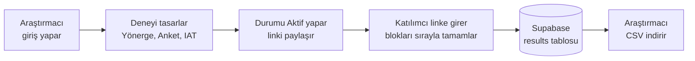

# PsycheTrack

**Psikoloji araştırmacıları için kod gerektirmeyen çevrimiçi deney platformu.**

PsycheTrack ile araştırmacılar Örtük Çağrışım Testi (IAT) tarzı tepki süresi görevlerini, anketleri ve yönergeleri tek bir deney akışında birleştirir. Deneyi sürükle bırak ile kurar, tek bir link ile katılımcılara gönderir, sonuçları analize hazır CSV olarak indirir.


---

## Neden?

Tepki süresi ölçen deneyler genelde pahalı lisanslı yazılımlar ya da programlama bilgisi gerektirir. PsycheTrack bu engeli kaldırır. Araştırmacı deneyini tarayıcıda tasarlar, katılımcı hesap açmadan linke tıklayıp katılır, veriler deneme bazında kaydedilir.

## Özellikler

### Araştırmacı tarafı
- **Deney paneli.** Deney oluşturma, silme ve durum takibi (Taslak, Aktif, Kapalı)
- **Blok tabanlı tasarım.** Bloklar sürükle bırak ile sıralanır
- **Üç blok türü**
  - **Yönerge** bloğu, katılımcıya görevi anlatan metin
  - **Anket** bloğu, açık uçlu ve çoktan seçmeli sorular, zorunlu alan seçeneği
  - **IAT** bloğu, iki kategori, metin ya da görsel uyaranlar, süre sınırı ve geri bildirim modu
- **Görsel uyaran yükleme.** Görseller güvenli depolama alanına yüklenir
- **Tek tıkla katılımcı linki.** Link panoya kopyalanır, istenen kanaldan paylaşılır
- **CSV dışa aktarma.** Her katılımcının her denemesi ayrı satır olarak indirilir

### Katılımcı tarafı
- Hesap açmadan katılım
- Deney sadece **Aktif** durumdayken erişilebilir
- IAT görevinde **E** ve **I** tuşlarıyla sınıflandırma
- Uyaranlar her katılımcı için rastgele sıralanır
- Tepki süresi `performance.now()` ile milisaniye hassasiyetinde ölçülür
- Üç geri bildirim modu. Düzeltme (doğru tuşa basılana kadar bekler), kısa hata işareti, geri bildirimsiz
- Açık ve koyu tema

## Nasıl çalışır?



## CSV çıktısı

Her satır bir katılımcının bir denemesine (ya da bir anket sorusuna) karşılık gelir. Başlıca sütunlar

| Sütun | Açıklama |
|---|---|
| `participant_index` | Katılımcı sırası |
| `block_type` | `instruction`, `survey` ya da `iat` |
| `question`, `answer` | Anket sorusu ve yanıtı |
| `iat_left_category`, `iat_right_category` | IAT kategori etiketleri |
| `trial_index` | Deneme sırası |
| `stimulus_value` | Gösterilen uyaran |
| `correct_side`, `response_side` | Doğru taraf ve verilen yanıt |
| `reaction_time` | Tepki süresi (ms) |
| `correct`, `timed_out` | Doğruluk ve zaman aşımı |
| `iat_mean_rt`, `iat_accuracy` | Blok için ortalama tepki süresi ve yüzde doğruluk |

Bu format R, SPSS, JASP ya da Python ile doğrudan analize uygundur.

## Veri güvenliği

Veritabanında Supabase **satır düzeyi güvenlik (RLS)** kullanılır.

- Araştırmacılar sadece kendi deneylerini görür ve düzenler
- Katılımcılar sadece **Aktif** deneylere yanıt gönderebilir
- Sonuçları sadece deneyin sahibi okuyabilir
- Katılımcıdan kimlik bilgisi alınmaz

## Teknolojiler

| Katman | Kullanılan |
|---|---|
| Arayüz | React 18, TypeScript, Vite |
| Stil ve bileşenler | Tailwind CSS, shadcn/ui, Radix UI, lucide-react |
| Sürükle bırak | dnd-kit |
| Form ve doğrulama | React Hook Form, Zod |
| Veri ve durum | TanStack Query, React Router |
| Arka uç | Supabase (PostgreSQL, Auth, Storage) |

## Proje yapısı

```
src/
├── pages/            # Ana sayfalar (giriş, panel, deney tasarımı, katılımcı ekranı)
├── components/
│   ├── builder/      # Blok editörleri (Yönerge, Anket, IAT)
│   ├── runner/       # Katılımcının gördüğü blok ekranları
│   └── ui/           # shadcn/ui bileşenleri
├── hooks/            # useAuth vb.
├── lib/csvExport.ts  # Sonuçları CSV'ye çeviren modül
└── types/            # Deney ve blok veri tipleri
supabase/migrations/  # Veritabanı şeması ve RLS politikaları
```

## Yerelde çalıştırma

Node.js 18 ya da üstü gerekir.

```sh
git clone https://github.com/henesatasoy/psyche-track.git
cd psyche-track
npm install
npm run dev
```

Proje kendi Supabase projesine bağlanır. Kendi Supabase projenizi kullanmak için `.env` dosyasındaki değerleri değiştirin ve `supabase/migrations` klasöründeki SQL dosyalarını sırayla çalıştırın.

```env
VITE_SUPABASE_URL=...
VITE_SUPABASE_PUBLISHABLE_KEY=...
VITE_SUPABASE_PROJECT_ID=...
```

## Yol haritası

- [ ] Klasik 7 bloklu IAT yapısı ve D-skoru hesaplama
- [ ] Bilgilendirilmiş onam bloğu
- [ ] Panelde katılımcı sayısı ve temel istatistikler
- [ ] Deney kopyalama

## Geliştirici

**Hüseyin Enes Atasoy** · Selçuk Üniversitesi Psikoloji

Proje [Lovable](https://lovable.dev) ile geliştirildi.
